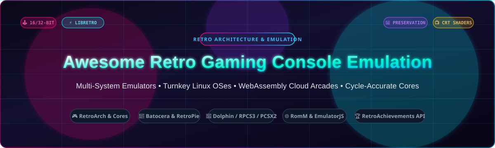

<div align="center">

<a href="https://github.com/ishandutta2007/Awesome-Awesome-Awesome"></a><a href="https://discord.gg/jc4xtF58Ve"></a>
<a href="https://github.com/ishandutta2007/Awesome-Retro-Gaming-Console-Emulation/stargazers"></a>
<a href="https://github.com/ishandutta2007/Awesome-Retro-Gaming-Console-Emulation/network/members"></a>
<a href="https://github.com/ishandutta2007/Awesome-Retro-Gaming-Console-Emulation/issues"></a>
<a href="https://github.com/ishandutta2007/Awesome-Retro-Gaming-Console-Emulation/blob/main/LICENSE"></a>
<a href="https://github.com/ishandutta2007"></a>

<br/><br/>

<a href="https://github.com/ishandutta2007/Awesome-Retro-Gaming-Console-Emulation">
  
</a>

# 🕹️ Awesome Retro Gaming & Console Emulation 🎮

[](https://github.com/ishandutta2007/Awesome-Retro-Gaming-Console-Emulation/pulls)
[](https://github.com/ishandutta2007/Awesome-Retro-Gaming-Console-Emulation)
[](https://github.com/ishandutta2007/Awesome-Awesome-Awesome)

**A comprehensive, curated directory of top-tier multi-system emulators, retro gaming Linux operating systems, library frontends, low-level cycle-accurate console cores, and self-hosted WebAssembly cloud arcades.**

</div>

---

## 📑 Table of Contents

- [🌟 Overview](#-overview)
- [📊 Sector Overview & Market Dynamics](#-sector-overview--market-dynamics)
- [🏢 SaaS & Hosted Gaming Platforms](#-saas--hosted-gaming-platforms)
- [💻 Open-Source GitHub Projects](#-open-source-github-projects)
  - [Top Projects Ranked by Community Stars](#-top-projects-ranked-by-community-stars)
  - [Featured Categories & Architectural Stacks](#-featured-categories--architectural-stacks)
- [🛠️ Recommended System Architecture](#️-recommended-system-architecture)
- [🤝 How to Contribute](#-how-to-contribute)
- [💖 Support](#-support)
- [📈 Star History](#-star-history)
- [⚖️ Disclaimer & Legal Preservation Notice](#️-disclaimer--legal-preservation-notice)

---

## 🌟 Overview

The **Retro Gaming & Console Emulation ecosystem** bridges video game history, digital preservation, and cutting-edge software engineering. These tools emulate legacy arcade machines, home video game consoles, handheld systems, and vintage PC architectures through cycle-accurate CPU/GPU interpretation, LLVM and Vulkan dynamic recompilation (JIT), low-latency input pipelines, run-ahead latency suppression, and CRT shader simulations.

Whether you are configuring a living room HTPC with **Batocera.linux**, setting up a multi-system macOS library via **OpenEmu**, pushing 4K internal resolutions on **Dolphin** and **RPCS3**, or streaming legally preserved ROM collections across browsers using **RomM** and **EmulatorJS**, this repository collects the most active, reliable, and high-performance solutions available.

---

## 📊 Sector Overview & Market Dynamics

The global retro gaming and classic video game emulation market is estimated at **$1.6B to $2.2B**, expanding as part of the broader $250B+ global video game and cloud streaming industry. The market is **moderately fragmented**: subscription-based streaming catalogs and first-party retro distributions are concentrated among major platform holders (e.g., Nintendo Switch Online, Sony PlayStation Plus Classics) and specialized licensed streaming services (such as Antstream Arcade), while the emulator frontend, low-level core, and hardware emulation tooling landscape remains decentralized and driven by open-source non-profit foundations, standalone open-source software, and passionate developer communities.

---

## 🏢 SaaS & Hosted Gaming Platforms

The table below lists leading commercial, subscription, and hosted retro gaming ecosystems, ordered descending by estimated company scale (annual revenue / valuation):

| 🏷️ Platform | 🏢 Company Scale (Revenue / Valuation) | 💳 Starting Tier Pricing | 🎁 Free Tier Limit / Trial | 📖 Description |
| :--- | :--- | :--- | :--- | :--- |
| [Sony PlayStation Plus Classics](https://playstation.com) | ~$85 Billion (Sony Group Gaming Rev.) | $17.99 / month (PlayStation Plus Premium) | 14-day free trial on selected regional promotions (full catalog access during trial) | Curated cloud-streaming and downloadable catalog of emulated PS1, PS2, PSP, and PS3 classics with save states and trophy rewards. |
| [Nintendo Switch Online (Classic Libraries)](https://nintendo.com) | ~$11 Billion (Nintendo Annual Rev.) | $49.99 / year (NSO + Expansion Pack individual) | 7-day free trial (access to standard NES, SNES, and Game Boy retro libraries) | Official cloud-synced console subscription delivering authentic emulation libraries for NES, SNES, N64, Genesis, GBA, and Game Boy with online multiplayer. |
| [Parsec](https://parsec.app) | ~$420 Million (Acquired by Unity) | $9.99 / month per user (Parsec Warp) | Free plan available (unlimited personal low-latency 60 FPS remote desktop game streaming & peer-to-peer couch co-op) | Ultra-low-latency remote interactive desktop engine widely used to stream emulators and play local couch multiplayer titles over the internet. |
| [LaunchBox & Big Box](https://launchbox-app.com) | ~$5 Million - $10 Million (Independent) | $39.95 one-time perpetual license ($15 for 1-year updates) | Free forever desktop edition (unlimited games & local scraping; Big Box 10-foot controller UI and custom themes locked) | Rich Windows and Android retro game library organizer and frontend featuring automatic metadata scraping, EmuMovies media sync, and living-room UI. |
| [Antstream Arcade](https://antstream.com) | ~$3 Million - $8 Million (Venture-backed) | $4.99 / month or $39.99 / year | Free ad-supported tier (play 1,300+ licensed arcade, Atari, Commodore, and Sega games with banner ads & daily challenge credits) | Commercial cloud retro-gaming streaming platform offering instant browser, console, and mobile access to over 1,300 licensed retro games with global leaderboards. |
| [Evercade (Blaze Entertainment)](https://evercade.co.uk) | ~$3 Million - $7 Million (Hardware & Licensing) | $24.99 per physical multi-game cartridge | Free bundled cartridge included with initial hardware console purchase (no subscription required) | Dedicated physical cartridge retro gaming ecosystem and handheld consoles partnering with classic publishers for licensed arcade and console compilations. |
| [RetroAchievements](https://retroachievements.org) | Community Non-Profit / Open Web Service | 100% Free / Optional community Patreon starting at $3.00 / month | 100% Free forever (unlimited accounts, unlocked achievements, leaderboards, and emulator API tokens) | Community-powered hosted service and public REST API that injects modern achievement trophies, rich presence, and leaderboards into classic ROMs across RetroArch and standalones. |

---

## 💻 Open-Source GitHub Projects

### 🏆 Top Projects Ranked by Community Stars

The following open-source emulators, frontends, distributions, and preservation servers are sorted in descending order by GitHub community stars:

| 🎮 Repository | ⭐ Stars | 📂 Core Role | 💻 Primary Target Platforms | 📝 Highlights |
| :--- | :--- | :--- | :--- | :--- |
| **[RPCS3](https://github.com/RPCS3/rpcs3)** | [](https://github.com/RPCS3/rpcs3/stargazers) | PS3 Console Emulator | Windows, Linux, macOS, FreeBSD | High-performance C++ Sony PlayStation 3 emulator & debugger powered by LLVM recompilers and Vulkan rendering. |
| **[OpenEmu](https://github.com/OpenEmu/OpenEmu)** | [](https://github.com/OpenEmu/OpenEmu/stargazers) | Modular Multi-System Frontend | macOS | Beautiful native macOS game organizer and multi-core emulation player with CoreAnimation/Metal shaders and automated artwork downloading. |
| **[PCSX2](https://github.com/PCSX2/pcsx2)** | [](https://github.com/PCSX2/pcsx2/stargazers) | PlayStation 2 Emulator | Windows, Linux, macOS | Definitive PlayStation 2 emulator featuring internal resolution scaling up to 8K, widescreen patches, and modern Qt GUI. |
| **[Dolphin](https://github.com/dolphin-emu/dolphin)** | [](https://github.com/dolphin-emu/dolphin/stargazers) | GameCube & Wii Emulator | Windows, Linux, macOS, Android | Benchmark Nintendo GameCube and Wii emulator with rollback netplay, 4K rendering, action-replay cheats, and physical Wiimote integration. |
| **[PPSSPP](https://github.com/hrydgard/ppsspp)** | [](https://github.com/hrydgard/ppsspp/stargazers) | PSP Handheld Emulator | Windows, macOS, Linux, Android, iOS | Ultra-fast PlayStation Portable emulator written in C++ with Vulkan, upscale texturing, post-processing shaders, and local multiplayer. |
| **[RetroArch](https://github.com/libretro/RetroArch)** | [](https://github.com/libretro/RetroArch/stargazers) | Universal Libretro Frontend | Multi-Platform (PC, Consoles, Mobile) | Flagship reference frontend for the libretro API; supports run-ahead latency elimination, CRT Slang shaders, netplay, and RetroAchievements. |
| **[Playnite](https://github.com/JosefNemec/Playnite)** | [](https://github.com/JosefNemec/Playnite/stargazers) | Unified Gaming Library Manager | Windows | Extensible video game library frontend unifying Steam, GOG, Epic, and dozens of standalone emulators with controller full-screen navigation. |
| **[RomM](https://github.com/rommapp/romm)** | [](https://github.com/rommapp/romm/stargazers) | Self-Hosted ROM Manager | Docker, Linux, Self-Hosted Web | Clean self-hosted ROM collection manager with automated IGDB metadata enrichment, save-state management, and in-browser emulation streaming. |
| **[DuckStation](https://github.com/stenzek/duckstation)** | [](https://github.com/stenzek/duckstation/stargazers) | PlayStation 1 Emulator | Windows, Linux, macOS, Android | Highly accurate Sony PlayStation 1 emulator featuring PGXP geometry correction, true-color 24-bit rendering, and RetroAchievements. |
| **[MAME](https://github.com/mamedev/mame)** | [](https://github.com/mamedev/mame/stargazers) | Arcade & Vintage Hardware Emulator | Windows, Linux, macOS | Monumental hardware preservation architecture emulating thousands of vintage arcade system boards, early microcomputers, and classic synthesizers. |
| **[RetroPie](https://github.com/RetroPie/RetroPie-Setup)** | [](https://github.com/RetroPie/RetroPie-Setup/stargazers) | Modular SBC Retro Gaming Suite | Raspberry Pi, Debian, Ubuntu | Classic automated configuration scripts setting up Raspberry Pi and Linux systems with EmulationStation, RetroArch, and standalone engines. |
| **[Cemu](https://github.com/cemu-project/Cemu)** | [](https://github.com/cemu-project/Cemu/stargazers) | Wii U Console Emulator | Windows, Linux, macOS | Highly optimized Nintendo Wii U emulator featuring graphic pack mods, high-framerate patches, and Vulkan backend rendering. |
| **[mGBA](https://github.com/mgba-emu/mgba)** | [](https://github.com/mgba-emu/mgba/stargazers) | Game Boy Advance Emulator | Windows, Linux, macOS, 3DS, Switch | Fast, cycle-accurate Game Boy, Game Boy Color, and Game Boy Advance emulator featuring solar sensor emulation, link cable emulation, and debugging tools. |
| **[melonDS](https://github.com/melonDS-emu/melonDS)** | [](https://github.com/melonDS-emu/melonDS/stargazers) | Nintendo DS / DSi Emulator | Windows, Linux, macOS | Accurate Nintendo DS and DSi emulator providing 3D OpenGL upscaling, microphone input simulation, and local Wi-Fi link connectivity. |
| **[EmulatorJS](https://github.com/EmulatorJS/EmulatorJS)** | [](https://github.com/EmulatorJS/EmulatorJS/stargazers) | Browser WebAssembly Emulator Player | Web, Self-Hosted, Client-side JS | Zero-install web client embedding multi-system RetroArch libretro cores into browsers via WebAssembly and WebGL. |
| **[VBA-M](https://github.com/visualboyadvance-m/visualboyadvance-m)** | [](https://github.com/visualboyadvance-m/visualboyadvance-m/stargazers) | Classic Game Boy Advance Emulator | Windows, Linux, macOS | Modern evolution of VisualBoyAdvance providing Game Boy, GBC, and GBA emulation with pixel filters and audio enhancements. |
| **[Snes9x](https://github.com/snes9xgit/snes9x)** | [](https://github.com/snes9xgit/snes9x/stargazers) | Super Nintendo (SNES) Emulator | Multi-Platform (C++) | Legendary portable Super Nintendo Entertainment System emulator with decades of refinement, satellite BS-X support, and DSP/Super FX chips. |
| **[Batocera.linux](https://github.com/batocera-linux/batocera.linux)** | [](https://github.com/batocera-linux/batocera.linux/stargazers) | Standalone Retro Gaming OS | x86-64, Steam Deck, SBCs, Handhelds | Appliance-like Linux distribution turning PCs and handhelds into plug-and-play gaming consoles with Kodi, gun support, and auto-configured controllers. |
| **[ScummVM](https://github.com/scummvm/scummvm)** | [](https://github.com/scummvm/scummvm/stargazers) | Classic Adventure Game Engine | Multi-Platform (Desktop, Mobile, Consoles) | Re-implements classic game script interpreters (LucasArts SCUMM, Sierra AGI/SCI, Humongous, Westwood) to run classic point-and-click titles natively. |
| **[BizHawk](https://github.com/TASEmulators/BizHawk)** | [](https://github.com/TASEmulators/BizHawk/stargazers) | Tool-Assisted Speedrun (TAS) Multi-Emulator | Windows, Linux | Multi-system emulation package engineered specifically for Tool-Assisted Speedrunning, memory inspection, Lua scripting, and frame-accurate rerecording. |
| **[Flycast](https://github.com/flyinghead/flycast)** | [](https://github.com/flyinghead/flycast/stargazers) | Sega Dreamcast & Naomi Emulator | Multi-Platform (Vulkan / OpenGL) | Multi-platform Sega Dreamcast, Naomi, Naomi 2, and Atomiswave emulator with cross-platform online netplay, widescreen hacks, and VMU screens. |
| **[Lakka](https://github.com/libretro/Lakka-LibreELEC)** | [](https://github.com/libretro/Lakka-LibreELEC/stargazers) | Minimalist RetroArch OS | Raspberry Pi, Generic PC, Allwinner | Lightweight Linux OS distribution built on LibreELEC dedicated exclusively to running RetroArch with zero background overhead. |
| **[Pegasus](https://github.com/mmatyas/pegasus-frontend)** | [](https://github.com/mmatyas/pegasus-frontend/stargazers) | Customizable QML Launcher Frontend | Windows, Linux, macOS, Android | Highly customizable cross-platform graphical frontend focused on performance, custom QML themes, and multi-launcher flexibility. |
| **[ares](https://github.com/ares-emulator/ares)** | [](https://github.com/ares-emulator/ares/stargazers) | Cycle-Accurate Multi-System Emulator | Windows, Linux, macOS | Multi-system emulator descended from Near's higan/bsnes focusing uncompromisingly on cycle accuracy, preservation, and modern hardware fidelity. |
| **[DOSBox Staging](https://github.com/dosbox-staging/dosbox-staging)** | [](https://github.com/dosbox-staging/dosbox-staging/stargazers) | Modernized MS-DOS Emulator | Windows, Linux, macOS | Modernized continuation of DOSBox featuring fluid frame pacing, Roland MT-32 and General MIDI emulation, pixel-perfect scaling, and modern audio pipelines. |
| **[FBNeo](https://github.com/finalburnneo/FBNeo)** | [](https://github.com/finalburnneo/FBNeo/stargazers) | Classic Arcade & Neo Geo Emulator | Multi-Platform (libretro core) | Multi-arcade emulator delivering peak performance and cycle timing for Neo-Geo, Capcom CPS1/2/3, Sega System 16, and vintage coin-op boards. |
| **[Mupen64Plus](https://github.com/mupen64plus/mupen64plus-core)** | [](https://github.com/mupen64plus/mupen64plus-core/stargazers) | Modular Nintendo 64 Emulator | Multi-Platform (Plugin Architecture) | Modular cross-platform Nintendo 64 emulator core utilizing dynamic recompilation, high-res texture replacements, and GLideN64 graphics plugins. |

---

### 🔍 Featured Categories & Architectural Stacks

- 🖥️ **Living Room & HTPC Appliance OSes**: [Batocera.linux](https://github.com/batocera-linux/batocera.linux), [RetroPie](https://github.com/RetroPie/RetroPie-Setup), [Lakka](https://github.com/libretro/Lakka-LibreELEC), [Recalbox](https://gitlab.com/recalbox/recalbox).
- 🗃️ **Universal Desktop Library Frontends**: [RetroArch](https://github.com/libretro/RetroArch), [Playnite](https://github.com/JosefNemec/Playnite), [OpenEmu](https://github.com/OpenEmu/OpenEmu), [Pegasus Frontend](https://github.com/mmatyas/pegasus-frontend).
- ⚡ **Flagship Console-Specific Emulators**:
  - **Nintendo**: [Dolphin](https://github.com/dolphin-emu/dolphin) (GC/Wii), [Cemu](https://github.com/cemu-project/Cemu) (Wii U), [melonDS](https://github.com/melonDS-emu/melonDS) (DS), [mGBA](https://github.com/mgba-emu/mgba) (GBA), [Snes9x](https://github.com/snes9xgit/snes9x) (SNES), [Mupen64Plus](https://github.com/mupen64plus/mupen64plus-core) (N64).
  - **Sony PlayStation**: [DuckStation](https://github.com/stenzek/duckstation) (PS1), [PCSX2](https://github.com/PCSX2/pcsx2) (PS2), [RPCS3](https://github.com/RPCS3/rpcs3) (PS3), [PPSSPP](https://github.com/hrydgard/ppsspp) (PSP).
  - **Sega & Arcade**: [MAME](https://github.com/mamedev/mame), [FBNeo](https://github.com/finalburnneo/FBNeo), [Flycast](https://github.com/flyinghead/flycast) (Dreamcast).
- 🌐 **Self-Hosted & Cloud Web Playback**: Combine [RomM](https://github.com/rommapp/romm) with [EmulatorJS](https://github.com/EmulatorJS/EmulatorJS) in Docker containers to build your private Netflix-style retro arcade accessible via mobile and web browsers.
- 🎯 **Preservation & Accuracy**: [ares](https://github.com/ares-emulator/ares) and [ScummVM](https://github.com/scummvm/scummvm).

---

## 🛠️ Recommended System Architecture

```text
┌────────────────────────────────────────────────────────┐
│             Self-Hosted Retro Cloud Stack              │
│                                                        │
│  [ Web Browser / Mobile ] ──HTTP/Wasm──► [ EmulatorJS ]│
│                                                 │      │
│  [ Media / Metadata ] ◄──IGDB / Covers──► [ RomM ]     │
│                                                 │      │
│  [ Authentication & Security ] ────────► [ WireGuard ] │
└────────────────────────────────────────────────────────┘
```

For dedicated hardware, install **Batocera.linux** on a flash drive or mini PC for zero-configuration gaming with out-of-the-box controller mappings and automatic Bluetooth pairing.

---

## 🤝 How to Contribute

Contributions are warmly welcomed! Help preserve video game history and maintain the ecosystem:

1. 🍴 Fork the repository.
2. 🌿 Create a new feature branch (`git checkout -b feature/new-emulator`).
3. 📝 Add or update the entry in `README.md` following the tabular or category format.
4. 🔍 Ensure links are active and descriptions remain factual and objective.
5. 🚀 Submit a Pull Request with a clear explanation of your additions.

---

## 💖 Support

If you find this curated retro gaming and emulation resource helpful, please consider supporting the project:

- ⭐ **Star this repository** to help others discover it!
- 🍴 **Fork the repo** to contribute new emulators, cores, and tools.
- 📢 **Share with fellow gamers** across Discord, Reddit, and retro gaming communities.
- ☕ **Buy a Coffee / Sponsor**: Support ongoing maintenance and curation on the [GitHub Sponsors Dashboard](https://github.com/sponsors/ishandutta2007). Thank you for keeping classic game preservation alive!

---

## 📈 Star History

[](https://star-history.com/#ishandutta2007/Awesome-Retro-Gaming-Console-Emulation&Date)

---

## ⚖️ Disclaimer & Legal Preservation Notice

- 📋 This repository is a **community-curated directory** created solely for archival, educational, research, and hardware preservation purposes.
- ⚠️ **No Copyrighted Files**: This repository does not host, link to, or distribute copyrighted ROMs, ISOs, game discs, or proprietary BIOS/firmware files.
- 🛡️ Users are legally responsible for obtaining system firmware and software dumps directly from physical hardware and game cartridges or discs they legitimately own.
- 🔒 When deploying self-hosted web ROM platforms like [RomM](https://github.com/rommapp/romm) and [EmulatorJS](https://github.com/EmulatorJS/EmulatorJS), always secure endpoints behind private VPN tunnels (e.g., Tailscale, WireGuard) or zero-trust reverse proxies.
